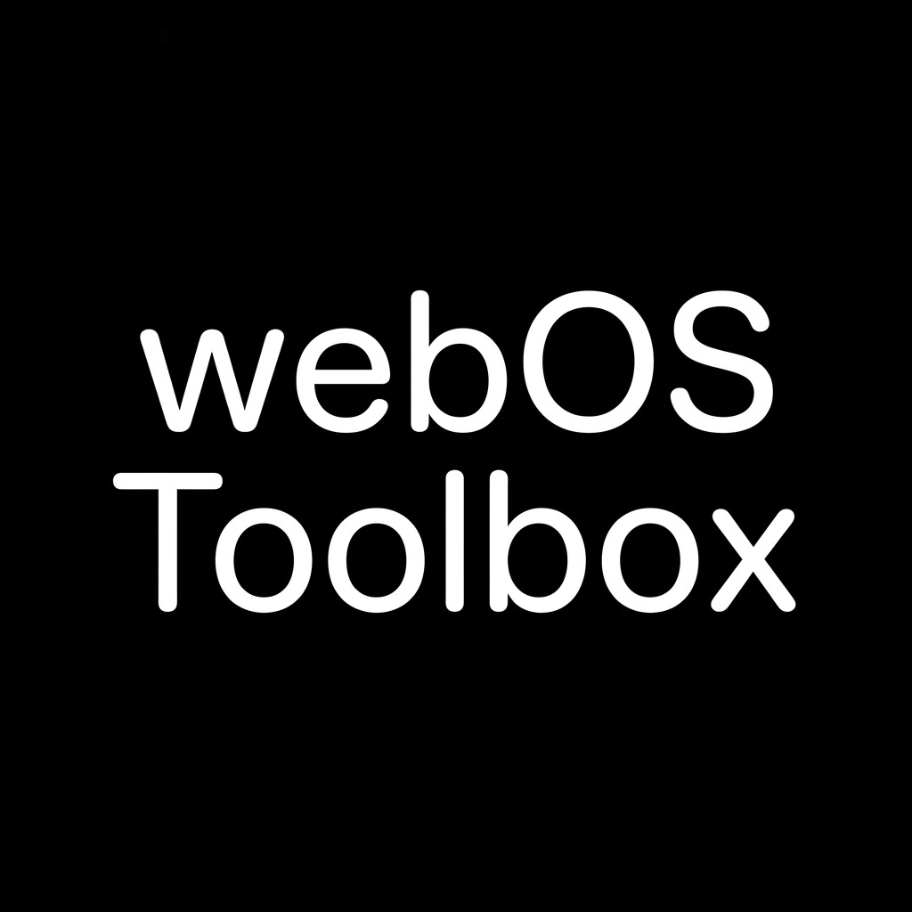

<p align="center">
  
</p>

<h1 align="center">webOS Toolbox</h1>

<p align="center">
  Desktop utility for LG Smart TV diagnostics, performance optimization, root shell, and homebrew management.
</p>

<p align="center">
  
  
  
</p>

---

## Overview

**webOS Toolbox** is a lightweight desktop application designed to manage, accelerate, and diagnose LG Smart TVs running webOS over local network. It supports both rooted TVs (via Telnet/SSH) and unrooted TVs (via official Developer Mode).

---

## Compatibility & Support Matrix

| webOS Version | Release Year | Typical SoC / Platform | Connection & Root Support |
| :--- | :--- | :--- | :--- |
| **webOS 3.5 – 3.9** | 2017 | M16+, LM14A | Root via RootMyTV / DevMode Mode B |
| **webOS 4.0 – 4.4** | 2018 | M7621, K5L (e.g. UK6xxx) | Homebrew Channel / Crashd / DevMode |
| **webOS 4.5 – 4.9** | 2019 | O18, M16P (e.g. UM7xxx) | Homebrew Channel / Telnet / DevMode |
| **webOS 5.0 – 5.4** | 2020 | O20, K7L (e.g. UN7xxx, CX) | CVE-2023-6317 / Root / DevMode |
| **webOS 6.0** | 2021 | O20N, LM21A (e.g. C1, UP7xxx) | CVE-2023-6317 / Root / DevMode |
| **webOS 22 (7.x)** | 2022 | O22, Realtek (e.g. C2, UQ) | Root / DevMode Key Server |
| **webOS 23 / 24** | 2023 – 2024 | O24, α7/α9/α11 Gen | Official Developer Mode (Port 9922) |

---

## Key Features

- **LAN Auto-Discovery**: Concurrent subnet scanner finds LG TVs on the local network automatically.
- **Hardware Telemetry**: Real-time CPU utilization, RAM consumption, and storage partition breakdown.
- **1-Click Performance Optimizer**:
  - Lowers kernel swappiness from 100 to 30 to reduce flash memory wear.
  - Stops background preloaders and diagnostic daemons (`webos-preload-manager`, `rdxd`, `cpud`).
  - Prioritizes UI compositor (`surface-manager-starfish`) to maintain smooth Magic Remote cursor tracking.
  - Blocks LG telemetry and promo ad servers via loopback `/etc/hosts`.
  - Cleans temporary checkpoint caches.
  - Installs a persistent, reversible startup script at `/var/lib/webosbrew/init.d/05-performance`.
- **Interactive Root Terminal**: Direct shell access over Telnet (port 23) and SSH (port 22) with quick diagnostic presets (`dmesg`, `logread`, `ps aux`, `df -h`, `reboot`).
- **App Manager & Sideloading**: Install local `.ipk` packages from your PC or browse homebrew catalog apps.
- **Setup Wizard**: Step-by-step guidance for pairing via Developer Mode or connecting to existing Root shells.
- **Bug Reporter**: Built-in 1-click diagnostic log generator that helps report issues directly to GitHub.

---

## Download & Usage

### Option 1: Standalone Portable EXE (Recommended)

1. Download `webOS-Toolbox.exe` from [Releases](https://github.com/itworksyett/webOS-Toolbox/releases).
2. Run the executable (no installation required).
3. Click **Scan LAN** to find your TV or enter its IP address manually.

### Option 2: Run from Source

```bash
# Clone the repository
git clone https://github.com/itworksyett/webOS-Toolbox.git
cd webOS-Toolbox

# Install dependencies
pip install -r requirements.txt

# Run the app
python main.py
```

---

## Building the Executable

To build the standalone `.exe` using PyInstaller:

```bash
pip install pyinstaller
python -m PyInstaller --noconfirm --clean --onefile --noconsole --name "webOS-Toolbox" --icon "ui\web\assets\icon.ico" --add-data "ui;ui" --collect-all pywebview main.py
```

The compiled binary will be located in the `dist/` directory.

---

## Safety

`webOS-Toolbox` operates exclusively in user-space:
- It does **not** alter read-only system partitions (`/old_root`, `tvservice`).
- All persistent optimization tweaks are placed in `/var/lib/webosbrew/init.d/` and can be removed at any time.

---

## License

This project is licensed under the [MIT License](LICENSE).
